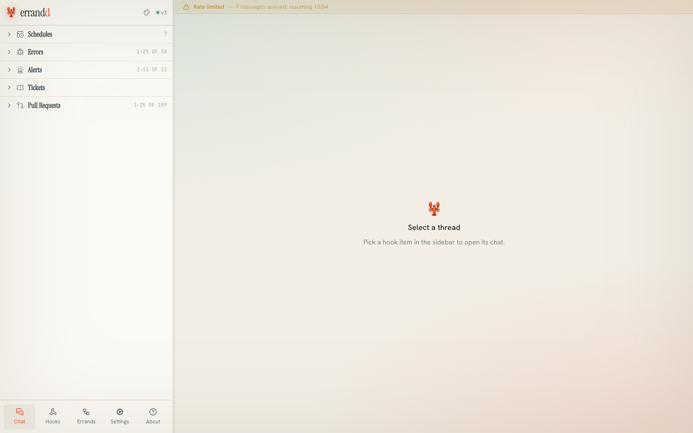
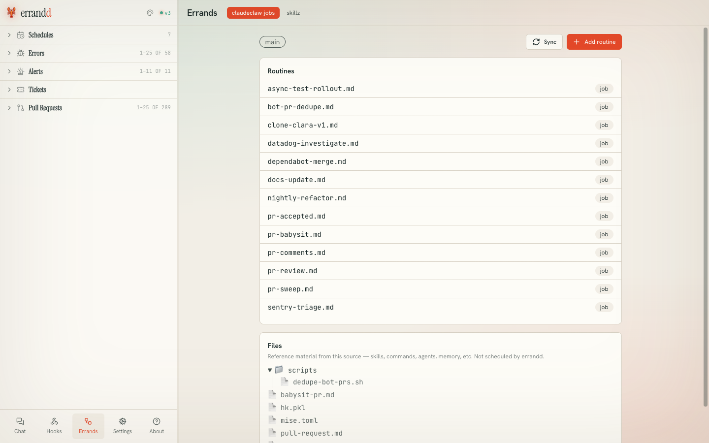
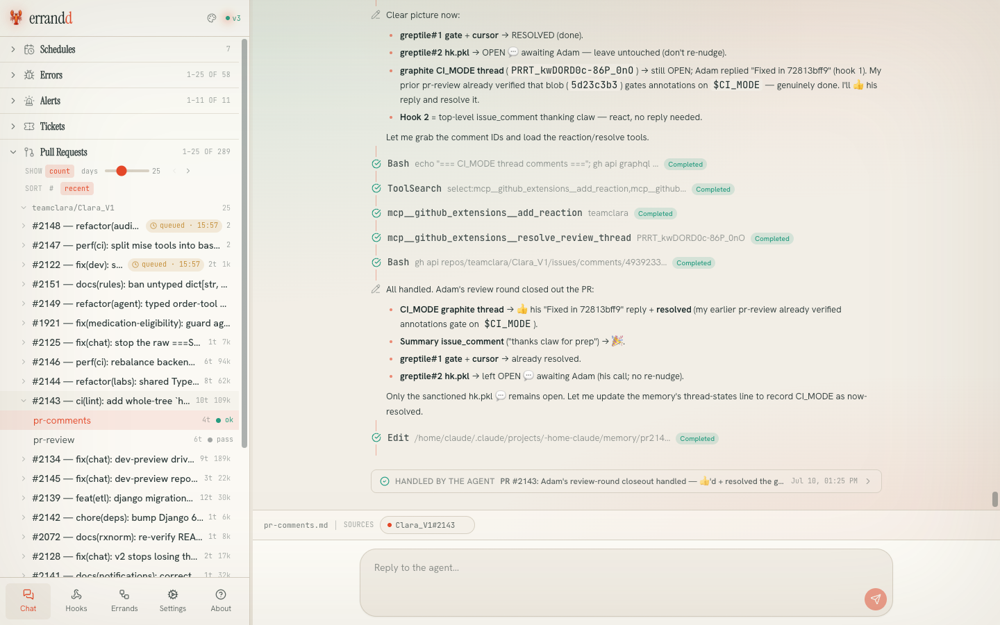

<h1 align="center">
  
</h1>

<p align="center">
  <a href="https://github.com/NorthIsUp/errandd/stargazers">
    
  </a>
  <a href="https://github.com/NorthIsUp/errandd/commits/main">
    
  </a>
  <a href="https://github.com/NorthIsUp/errandd/graphs/contributors">
    
  </a>
</p>

<p align="center"><b>A self-hosted daemon that puts your coding agent on watch — listening to your dev and prod environment and acting on what it sees.</b></p>

Errandd runs a coding-agent CLI — **Claude Code** by default, [**Pi**](https://pi.dev), or **Codex** — as a background daemon wired into the systems your team already uses. It **listens for events** (GitHub pull requests, Sentry errors, Datadog alerts, Linear issues) and **runs scheduled routines** (morning ticket triage, nightly sweeps, recurring checks). Each event or tick is matched against your **routines** — plain markdown files, version-controlled — and handed to the agent to investigate, triage, or fix. A web dashboard and Telegram/Discord/Slack bridges let you watch and steer it in real time.

It's built on the coding-agent subscription you already pay for — no per-call API bill, no cloud to trust with your source. _(Formerly clawdcode.)_

## How it works

```
GitHub · Sentry · Datadog · Linear ─┐
                                     ├─► match routines ─► enqueue job ─► agent (Claude / Pi) ─► investigate · triage · act
        cron schedule ──────────────┘
```

1. **An event arrives** — a signed webhook from GitHub/Sentry/Datadog/Linear, or a cron tick.
2. **It's matched** against every routine's `on:` triggers.
3. **Matches become durable jobs** on a queue (they survive restarts).
4. **The agent runs the routine** in an isolated session, using the tools your coding-agent CLI already has — reading the diff, querying logs, posting a review, opening a ticket.
5. **You watch and steer** from the dashboard or a chat bridge, and every delivery is recorded so nothing is silently dropped.

## Event sources

Errandd exposes one signed webhook per provider. Each incoming delivery is verified, recorded, and matched against your routines' triggers.

| Source | Endpoint | Auth | Triggers |
| --- | --- | --- | --- |
| **GitHub** | `POST /api/webhooks/github` | HMAC `X-Hub-Signature-256` — `ERRANDD_GITHUB_WEBHOOK_SECRET` | `prs`, `pr`, `comments`, `reviews`, `checks`, `issues` |
| **Sentry** | `POST /api/webhooks/sentry` | HMAC `Sentry-Hook-Signature` — `ERRANDD_SENTRY_CLIENT_SECRET` | `sentry` |
| **Datadog** | `POST /api/webhooks/datadog` | `X-Errandd-Token` / `?token=` — `ERRANDD_DATADOG_WEBHOOK_SECRET` | `datadog` |
| **Linear** | `POST /api/webhooks/linear` | HMAC `Linear-Signature` — `ERRANDD_LINEAR_WEBHOOK_SECRET` | `linear` |
| **CVEFeed** | `POST /api/webhooks/cvefeed` | Required `X-Webhook-Secret` — `ERRANDD_CVEFEED_WEBHOOK_SECRET` | `cve` |

**CVE monitoring:** Errands → Add CVE errand creates a disabled preset for official CVE updates (five-minute polling), with optional CVEFeed webhooks. Select repository checkboxes and filter by severity, ecosystem, language, technology, vendor or product. The default prompt assesses applicability and opens a tested fix PR only if affected. See [CVE setup and filter semantics](errandd/docs/CVE_MONITORING.md).

The GitHub receiver understands the real payloads — it parses pull requests, review comments, checks, and issues, skips its own bot activity, honors a `claw:ignore` label, and drops CI noise before it ever reaches the agent. Sentry keeps a first-seen ledger so you're triaged once per issue, not once per event. Datadog ships a recommended payload template you paste into your monitor.

Prefer to push events yourself? `POST /api/inject` runs a one-shot agent message from any script or CI step (bearer/web token, or a static `settings.apiToken`).

## Routines as code

A **routine** is a markdown file describing a task, with an `on:` block declaring what triggers it. Point Errandd at a git repo (`jobsRepo.url` / `ERRANDD_JOBSREPO_URL`) and every top-level `.md` file becomes a routine — cloned on start, pulled on an interval. Your automation lives in version control, reviewed like any other code.

```markdown
---
description: Review new and updated pull requests
on:
  - prs: true
---

Review the pull request diff for bugs, missing tests, and unclear code.
Leave inline review comments where you can be specific, then post a short
summary. Approve only if it's clearly safe.
```

Triggers combine freely — an event, a schedule, or both:

```markdown
---
description: Triage new Sentry issues, and sweep the backlog each morning
on:
  - sentry: true
  - schedule: "0 9 * * 1-5"
---

For each Sentry issue, find the offending code, assess severity and likely
cause, and open a Linear ticket with a proposed fix when it's actionable.
```

`on:` is a list of single-key triggers: `schedule` (a cron string), `prs`, `pr` (with filters), `comments`, `reviews`, `sentry`, `datadog`, `linear`, `checks`, `issues`. Cron schedules are timezone-aware (`ERRANDD_TIMEZONE`). Full trigger syntax lives in [`errandd/docs/PR_HOOKS_SPEC.md`](errandd/docs/PR_HOOKS_SPEC.md).

### Sharing content between routines (`@`-imports)

Pull shared instructions into a routine with an `@`-import — the file's contents are inlined when the routine runs:

```markdown
@shared/pr-preamble.md      ← relative to your jobs repo root
@./notes.md                 ← relative to this routine file's directory
@../common/style.md         ← walk up from this routine file
@some-plugin/prompts/x.md   ← inside a named jobs repo or installed plugin
```

The leading segment is resolved as a **known jobs-repo slug or plugin name** first; otherwise it's a path within your **current repo**. `@./` and `@../` are relative to the referencing file. Prefer these over hard-coded daemon paths like `@~/.claude/errandd/jobs/...` — those still work for backcompat but leak internal layout.

## Quick start

```bash
claude plugin marketplace add NorthIsUp/errandd
claude plugin install errandd
```

Then open a Claude Code session and run:

```
/errandd:start
```

The setup wizard walks you through the runtime, model, chat surfaces, event webhooks, and security level, then your daemon is live with a web dashboard. Add a jobs repo and your first routines run on the next tick or event.

## Pluggable runtimes

The exec runtime — the process that actually runs your prompts — sits behind one interface and is chosen once at startup:

- **Claude Code** (`claude`) — the default. Session resume, context-token reporting (which drives size-based auto-compaction), jobs-repo plugins/skills, and MCP server management all work.
- **Pi** ([`pi`](https://pi.dev), experimental) — an alternate coding-agent CLI. Errandd drives it with `--mode json -p`, resumes via `--session <id>`, and reads token usage per message so auto-compaction works the same. Pi documents *"No MCP"* by design, so MCP registration is inert and Claude-shaped plugin flags aren't forwarded — features a runtime can't back are switched off gracefully rather than breaking.
- **Codex** (`codex`) — drives `codex exec --json`, resumes with `codex exec resume`, and normalizes assistant messages, tool calls, and usage into the same dashboard stream. Uses the model configured in Codex unless Errandd specifies a model ID. Claude plugin installation and Errandd-managed MCP registration are disabled; Codex reads its own configured skills and MCP servers.

Select it with the `runtime` field in `.claude/errandd/settings.json` or the `ERRANDD_RUNTIME` env var (env wins). All three binaries ship in the Docker image, so **switching runtime is a restart, not a rebuild**:

```bash
docker run -e ERRANDD_RUNTIME=pi ... errandd                        # Docker
helm upgrade errandd errandd/charts/errandd --set runtime=pi     # Helm
# Codex uses a saved codex login or a CODEX_API_KEY:
docker run -e ERRANDD_RUNTIME=codex -e CODEX_API_KEY ... errandd
```

> Pi's version is **pinned to 0.80.6** (in both `mise.toml` and the `Dockerfile`) because the stream parser is written against the JSON event schema it emits. Bump it deliberately and re-run the e2e suite, which fails if the wire moved. The adapters are covered two ways — a conformance matrix asserting runtime adapters normalize to *identical* events, and an opt-in suite driving the real binaries (`cd errandd && ERRANDD_E2E=1 bun test app/__tests__/runtime-e2e.test.ts`).

## Watch and steer

- **Web dashboard** — every delivery, queued job, and run in real time: open a thread to read the agent's reasoning and tool calls, or chat with it directly. Manage routines, inspect logs, retrigger jobs.
- **Telegram / Discord / Slack** — first-class bridges, not just notifications. DMs, channel mentions, threads, slash commands, image attachments, and voice messages (transcribed). Discord threads each get their own isolated agent session that runs in parallel — see [`errandd/docs/MULTI_SESSION.md`](errandd/docs/MULTI_SESSION.md).
- **[AG-UI](https://ag-ui.com) endpoint** — `POST /api/agui` streams a turn as AG-UI SSE events (`RUN_STARTED` → `TEXT_MESSAGE_*` / `TOOL_CALL_*` → `RUN_FINISHED`), runtime-agnostic, for wiring Errandd into your own UI.

```bash
curl -N -X POST http://localhost:4632/api/agui \
  -H "Authorization: Bearer $(cat .claude/errandd/web.token)" \
  -H "Content-Type: application/json" \
  -d '{"prompt": "summarize the failed runs from today"}'
```

The dashboard chat uses AG-UI throughout. `POST /api/chat` accepts a
`messages` array (the last user message is submitted), `threadId`, and `runId`,
plus existing attachment and session metadata fields. Text arrives as
`TEXT_MESSAGE_START`, `TEXT_MESSAGE_CONTENT`, and `TEXT_MESSAGE_END`, followed
by `RUN_FINISHED`; failures emit `RUN_ERROR`. Background notifications use
`CUSTOM` events named `errandd.unblock`, `errandd.agent_spawn`, and
`errandd.agent_done` (agent details are in `value`).

Hook threads retain their durable queue: replies go to
`POST /api/v3/threads/:id/message`, and their persistent SSE subscription at
`GET /api/v3/threads/:id/stream` uses AG-UI `STATE_SNAPSHOT` and `STATE_DELTA`
events. State contains `parts` (including reasoning, tools, sources, and FYI
metadata) and `status`. Reconnecting receives a fresh snapshot. The separate
`/api/agui` endpoint above runs a standalone turn; its thread/run IDs identify
the stream, and do not resume a saved session.

## Chat framework demos

On `demo/ag-ui-chat`, `/demos/chat` is the gallery for the selected assistant-ui
integration. This is demo work; it does not add a standalone chat feature to
Errandd. The dashboard and its existing workflows remain the application.

| URL | Example |
| --- | --- |
| `/demos/chat/assistant-ui` | Interactive scripted demo: streaming, tool cards, Bash success/error, Markdown/HTML, stop, follow-ups, and `/error` |
| `/demos/chat/assistant-ui?mode=live` | The same UI connected to the configured local CLI agent |
| `/demos/chat/compare` | Original Errandd renderer beside assistant-ui, using private production captures |
| `/demos/chat/cards` | Immediately visible synthetic custom-card and Bash examples |

In the interactive demo, choose **Review a webhook with subagents** to exercise
the complete workflow: a single updating hook/job card, two expandable reviewer
transcripts, explicit run stages, a structured report with diff and download,
and an approval or decline that resumes the same thread. The Result detail
selector changes shared AG-UI state and affects the resumed response.
All activity is synthetic; approving completes the preview without publishing
a comment or executing a job.

assistant-ui's stock `useAgUiRuntime` and `HttpAgent` connect to the local
AG-UI endpoints. `/api/demos/agui` is a deterministic SSE fixture with no model,
command, or job execution; live mode uses Errandd's existing `/api/agui` CLI
adapter. assistant-ui supplies the UI and client runtime, while Errandd remains
the local server. No cloud account or additional service is involved.

The frontend uses assistant-ui's native `MessagePrimitive.GroupedParts` for
adjacent reasoning/tool groups, reuses the original rail steps and `ToolContent`
Bash renderer, isolates its dashboard stylesheet in a shadow root, and registers
small custom cards through named assistant-ui tool slots. User/hook messages
keep their original role and use sanitized Markdown/HTML. Vercel's opaque
webhook metadata is filtered only for display. Copy icons live inside the
upper-right corner of the box they copy.

Hook comments show the sender's name/avatar and a separate provider icon.
The [actor icon registry](errandd/web/chat/actorIcons.ts) maps service accounts
such as `vercel[bot]` and `datadog-official` to their existing organization
avatars; other GitHub users use their own avatar, with an icon fallback.
FYI messages have a dedicated notice box and stay outside model context.
Bash output that parses as JSON uses an expandable `react-json-view-lite`
tree; its copy action preserves the original raw output exactly.
Diff content in code blocks, file-edit notices, and shell output renders in a
shared unified viewer. Git/unified patches, headerless `+`/`-` snippets, normal
diffs, and context diffs are supported; copy preserves the original format.

Captured transcripts use the stock external-store runtime, disabled for
sending. A small converter keeps AG-UI activity cards in their original
positions. Captures and commands are never executed by the comparison view.

The [component audit](errandd/docs/assistant-ui-component-audit.json) reviews all
151 official catalog elements and the React primitive families, with a decision
and rationale for each. It distinguishes native APIs in use, custom presentation
worth retaining, future fits, and controls that need backend support.

Import examples from your own instance (through your existing proxy if needed):

```bash
cd errandd
tsmux run bun scripts/import-chat-examples.ts https://your-errandd.example \
  'pr-review:hook:pr-123' 'datadog-investigate:hook:your-alert'
```

For token-authenticated sources, supply `ERRANDD_CAPTURE_TOKEN` in the process
environment. Captures go to ignored local state at
`.claude/errandd/demos/chat-examples.json`, served only through authenticated
`GET /api/demos/chat-examples` with `Cache-Control: no-store`. Private messages
are never imported into the static bundle. The importer fetches at most 250
parts per source and labels the original total; obvious credential patterns
are redacted, but this is not a general sensitive-data scrubber.

The comparison makes adapter choices explicit: FYI/out-of-context blocks and
source annotations stay outside standard conversation messages. Generic tool
calls and results survive; custom work rails, source chips, file diffs, and
error badges need presentation adapters. Reasoning coverage is reported from
actual captured parts, without adding invented examples.

## Configuration

`.claude/errandd/settings.json` is the source of truth; every field can be overridden by an `ERRANDD_*` environment variable (env always wins). See `.env.example` for the full list.

| Variable | Overrides |
| --- | --- |
| `ERRANDD_RUNTIME` | Exec runtime: `claude` (default), `pi`, or `codex` |
| `ERRANDD_MODEL` / `ERRANDD_API` | Primary model and API |
| `ERRANDD_FALLBACK_MODEL` / `ERRANDD_FALLBACK_API` | Fallback model and API |
| `ERRANDD_TIMEZONE` | Timezone (also re-derives the cron offset) |
| `ERRANDD_JOBSREPO_URL` / `ERRANDD_JOBSREPO_BRANCH` / `ERRANDD_JOBSREPO_INTERVAL` | Jobs repo (clone + pull interval, default 300 s) |
| `ERRANDD_JOBSREPOS` | Comma-separated git URLs replacing the whole jobs-repo list |
| `ERRANDD_GITHUB_WEBHOOK_SECRET` | GitHub webhook HMAC secret |
| `ERRANDD_SENTRY_CLIENT_SECRET` | Sentry webhook HMAC secret |
| `ERRANDD_DATADOG_WEBHOOK_SECRET` | Datadog shared token |
| `ERRANDD_LINEAR_WEBHOOK_SECRET` | Linear webhook HMAC secret |
| `ERRANDD_API_TOKEN` | Static token for `POST /api/inject` |
| `ERRANDD_WEB_ENABLED` / `ERRANDD_WEB_HOST` / `ERRANDD_WEB_PORT` | Web dashboard |
| `ERRANDD_SECURITY_LEVEL` | Security level (read-only → full access) |
| `ERRANDD_TELEGRAM_TOKEN` | Telegram bot token (alias: `TELEGRAM_TOKEN`) |
| `ERRANDD_DISCORD_TOKEN` | Discord bot token (alias: `DISCORD_TOKEN`) |
| `ERRANDD_SLACK_BOT_TOKEN` / `ERRANDD_SLACK_APP_TOKEN` | Slack tokens (aliases: `SLACK_BOT_TOKEN`, `SLACK_APP_TOKEN`) |
| `ERRANDD_STT_BASE_URL` / `ERRANDD_STT_MODEL` | Voice transcription backend |

Nested arrays and objects (trigger scopes, agentic modes, allowed user IDs, plugins) are file-only.

## Deployment

### Docker

```bash
docker build -t errandd .
docker run -p 4632:4632 -v $PWD/.claude:/app/.claude --env-file .env errandd
```

- **All runtimes are baked in** — `claude`, `pi@0.80.6`, and `codex@0.163.0` — defaulting to `claude`. Switch with `-e ERRANDD_RUNTIME=pi`; no rebuild.
- **State persists in the `/app/.claude` volume** (jobs, logs, tokens, session transcripts). The image symlinks `~/.claude` → `/app/.claude` , `~/.pi` → `/app/.claude/pi`, and `~/.codex` → `/app/.claude/codex`, so `--resume`/`--session` survive restarts. Mount a *persistent* volume — an anonymous one resets per container.
- **Health:** a `HEALTHCHECK` polls `/readyz` (503 until startup finishes, 200 when ready). Liveness is `/healthz`.

Codex uses a saved `codex login` in the persisted `~/.codex` directory or `CODEX_API_KEY` for non-interactive runs. Set `ERRANDD_RUNTIME=codex`; optionally set `CODEX_EXECUTABLE` to use a custom binary. See the [official Codex CLI documentation](https://developers.openai.com/codex/cli/) and [authentication guide](https://developers.openai.com/codex/auth/).

Claude auth comes from the mounted `.claude` volume (if it holds credentials from a local `claude` login) or a `CLAUDE_CODE_OAUTH_TOKEN` from `claude setup-token`.

### Helm

A chart ships at [`errandd/charts/errandd`](errandd/charts/errandd):

```bash
helm install errandd errandd/charts/errandd
helm upgrade errandd errandd/charts/errandd --set runtime=pi   # switch runtime, same image
```

Key values: `runtime`, `persistence.*` for the `/app/.claude` PVC, `secrets.*`, `ingress.*`, and an `env:` map for arbitrary `ERRANDD_*` overrides. The daemon is single-instance and stateful — the chart keeps `replicaCount: 1` with a `Recreate` strategy.

### Local development

```bash
cd errandd       # the whole project lives here; the repo root is plugin-dist only
mise install     # bun, node, biome, hk — and the pinned pi runtime
mise run setup   # bun install + hk git hooks
bun run start    # run the daemon
```

The web dashboard is a React + TypeScript app (`errandd/web/`) built with Bun's bundler and served from `dist/web/`. Build with `bun run build:web`, watch with `bun run dev:web`. All `/api/*` routes (except health) are gated by a web auth token, auto-generated on first start and written to `.claude/errandd/web.token`.

## Screenshots

### The web dashboard

<p align="center">
  
</p>

_Every incoming event — GitHub PRs, Sentry errors, Datadog alerts, Linear issues — becomes a thread you can open and chat with the agent about._

### Routines

<p align="center">
  
</p>

_Routines sync from your jobs repo and run on a schedule or in response to events — toggle them on and off without touching the files._

### The agent at work

<p align="center">
  
</p>

_A run's detail: streamed reasoning, tool calls, and outcome — here the agent resolves a PR's review threads and posts its replies._

## FAQ

<details open>
  <summary><strong>Do I have to give it production access?</strong></summary>
  <p>
    No. Errandd runs at one of four security levels, from read-only to full system
    access, and sessions are folder-isolated. Start it read-only, watch what it does
    from the dashboard, and widen access only where you want it to act.
  </p>
</details>

<details open>
  <summary><strong>Where do my routines and automation live?</strong></summary>
  <p>
    In a git repo you control — one markdown file per routine, cloned and pulled on
    an interval. Your automation is reviewed, versioned, and diffable like any other
    code, not locked inside a SaaS console.
  </p>
</details>

<details open>
  <summary><strong>Which coding agents does it support?</strong></summary>
  <p>
    Claude Code by default, or Pi (experimental). The runtime is pluggable and chosen
    at startup — both binaries ship in the image, so switching is a restart, not a rebuild.
  </p>
</details>

<details open>
  <summary><strong>Can Errandd do &lt;something&gt;?</strong></summary>
  <p>
    If your coding-agent CLI can do it, Errandd can too. On top it adds event listeners,
    schedules, a durable job queue, and the chat/dashboard surfaces. Teach it new
    skills and workflows the same way you would the CLI.
  </p>
</details>

## Contributing

```bash
cd errandd       # the repo root holds only the plugin; everything else is here
mise install     # pinned toolchain, including pi 0.80.6
mise run setup   # bun install + hk git hooks (pre-commit: eslint + typecheck; pre-push: tests + web build)
```

**Before opening any PR**, bump the plugin metadata — both are required CI guards:

```bash
bun run bump:plugin-version
bun run bump:marketplace-version
```

The `plugin-version-guard` and `marketplace-version-guard` checks fail if `.claude-plugin/plugin.json` or `.claude-plugin/marketplace.json` still carry the merge-base version — commit the bumps alongside your changes and push before creating the PR.
